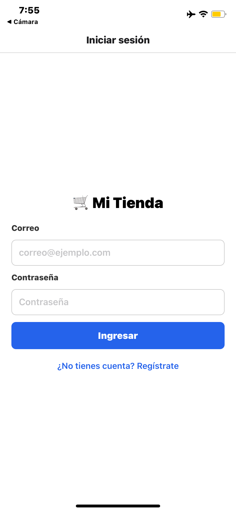
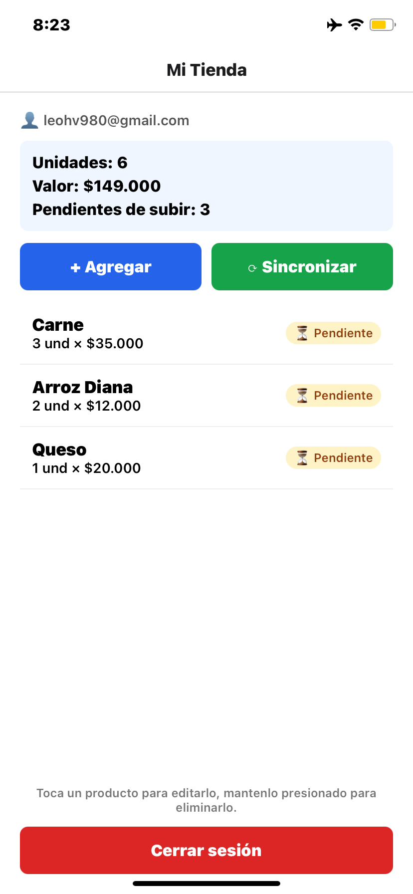
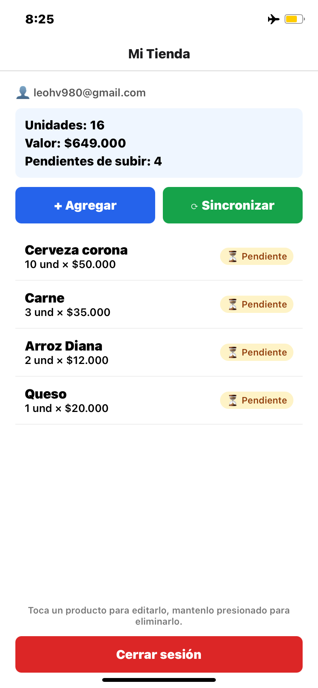
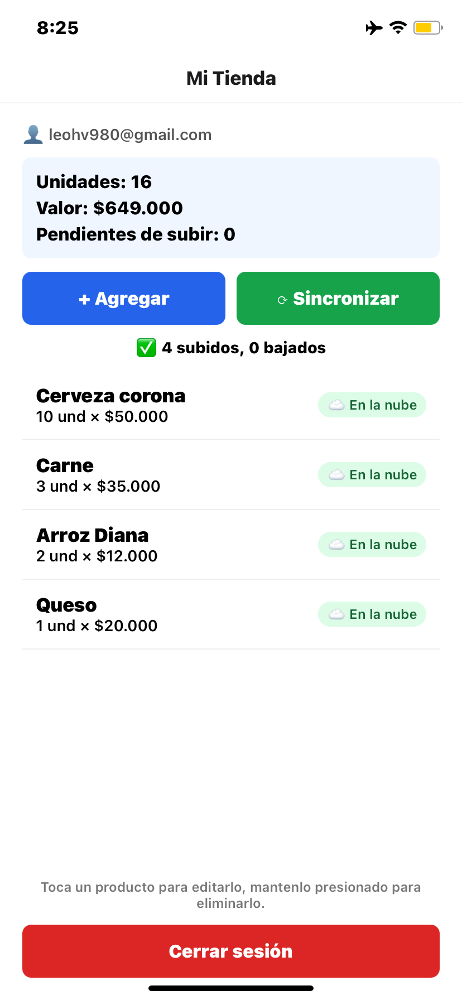

# Parcial: Mi Tienda

**Estudiante:** Leonardo Hernández
**Código:** 0182220036

## Cómo ejecutar
1. Copiar .env.example como .env y llenar URL y publishable key de Supabase.
2. Ejecutar en el SQL Editor de Supabase el script de la tabla products con RLS y desactivar Confirm email.
3. npm install --legacy-peer-deps
4. npx expo start

## Capturas

## Estado
Funciona: login, registro con validaciones, rutas protegidas con Stack.Protected, sesión persistente en SecureStore, CRUD local con SQLite y Drizzle (también sin conexión), lista reactiva con useLiveQuery, totales, indicador de 0182220036s y sincronización con Supabase (baja faltantes y sube 0182220036s con upsert por client_id).

Faltaron por tiempo las capturas de registro, formulario y panel de Supabase.
